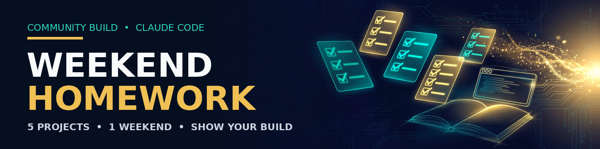
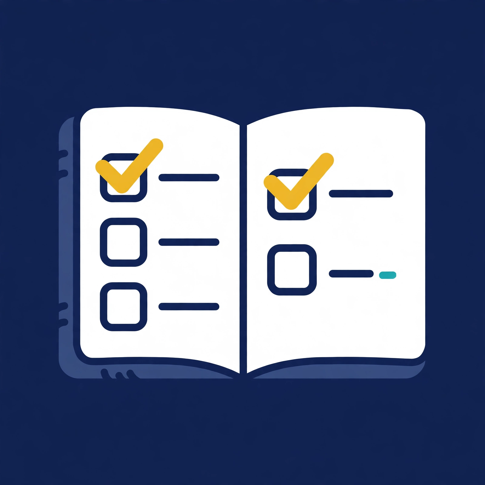
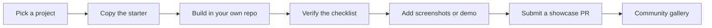

<p align="center">
  
</p>

<p align="center"></p>

<h1 align="center">Weekend Homework</h1>

<p align="center"><strong>Five Claude Code projects. One weekend. A community gallery of finished builds.</strong></p>

<p align="center">
  <a href="LICENSE"></a>
  
  
  
</p>

## The idea

Five Claude Code projects that teach you more than a certification:

1. a personal dashboard,
2. a searchable second brain,
3. a daily review agent,
4. a brand-kit generator, and
5. a life library.

This repository turns them into an open build-along. Each project has a practical guide, a starter `CLAUDE.md`, a build checklist, and a definition of done. Build one, build all five, then submit your version to the community showcase.


## Start here

1. Read [PRINCIPLES.md](PRINCIPLES.md).
2. Follow the schedule in [WEEKEND-PLAN.md](WEEKEND-PLAN.md), or pick a single project.
3. Open a project guide, copy its starter files into your own repository, and build in small verified steps.
4. Record a short demo — screenshots are fine — and submit it with [the showcase template](showcase/SUBMISSION_TEMPLATE.md).
5. Open a pull request that adds your submission under `showcase/submissions/`.

## The five builds

| # | Project | What you learn | Best outcome | Timebox |
|---|---|---|---|---:|
| 1 | [Personal Dashboard](projects/01-personal-dashboard/GUIDE.md) | APIs, data joins, scheduling, UI | A morning briefing that uses your real calendar, tasks and inbox summaries | 2–3 hrs |
| 2 | [Second Brain](projects/02-second-brain/GUIDE.md) | Document ingestion, search, chunking, local AI | Ask questions across your PDFs, notes and contracts | 3 hrs |
| 3 | [Daily Review Agent](projects/03-daily-review-agent/GUIDE.md) | Agents, reflection loops, memory | An end-of-day review and weekly pattern report | 1.5–2 hrs |
| 4 | [Brand Kit Generator](projects/04-brand-kit-generator/GUIDE.md) | Structured generation, design tokens, deliverables | A client-ready brand kit from a business brief | 2–3 hrs |
| 5 | [Life Library](projects/05-life-library/GUIDE.md) | Capture, metadata, recommendations | A searchable library of everything you save and learn | 2 hrs |

## How the community build works



### Submission rules

- Your code lives in your repository; this repo collects the showcase record.
- Link to a public repo or a clearly labelled demo.
- Include at least one screenshot, a short write-up, and what you changed from the guide.
- Never submit private documents, API keys, client data or another person's work as your own.
- Local-first projects must say plainly if you changed them to use a cloud service.
- A beautiful mock-up is not a finished build. Show it working.

See [CONTRIBUTING.md](CONTRIBUTING.md), [COMMUNITY.md](COMMUNITY.md), and the live [SHOWCASE.md](SHOWCASE.md).

## Why a lead magnet should be this useful

Most "free guides" are a PDF and a sales pitch. This one is a working curriculum:

- **Dream outcome:** five working AI projects and portfolio proof.
- **Likelihood of success:** specs, prompts, checklists and examples reduce the guessing.
- **Time delay:** each build is scoped to a weekend session.
- **Effort:** starter files and definitions of done remove setup friction.

Give away the useful thing. Let the finished work build the community.

## Notion version

The `notion/` folder contains an import-ready home page, project pages and a CSV tracker that becomes a Notion database. See [notion/README.md](notion/README.md).

## Repository map

```text
projects/          The five guided builds
showcase/          Submission template and accepted-build records
community-builds/  Build-weekend announcements and recaps
notion/            Notion import package
assets/            Banner and icon
.github/           Issue and pull-request templates
```

## Licence

MIT. Build with it, teach with it, and credit the project when you redistribute the guide pack.
