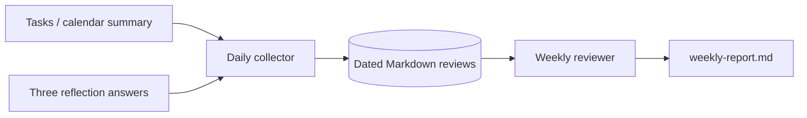

# 03 — Daily Review Agent

> Weekend Homework project page. Keep your notes, decisions, screenshots and demo link on this page.

| Field | Value |
|---|---|
| Status | Not started |
| Repository |  |
| Demo |  |
| Date finished |  |

## My build notes

- My twist:
- My stack changes:
- Biggest blocker:
- What I would do next:

---

## Outcome

Build a small agent that closes the day instead of letting it blur into the next one. It collects what happened, asks a short reflection, identifies friction, and produces a weekly pattern report.

**Timebox:** 1.5–2 hours  
**Difficulty:** Beginner  
**Core skills:** agent loops, structured memory, journaling, summarization, pattern detection

## What the finished build does

- Imports or reads the day’s completed and unfinished tasks.
- Asks three short end-of-day questions.
- Stores a dated Markdown review.
- Extracts wins, friction, lessons and tomorrow’s first move.
- Generates a weekly report that spots repeated blockers and unfinished loops.
- Keeps the tone factual and useful — no motivational-poster voice.

## Architecture



## Suggested stack

- Python CLI
- Markdown files in a `reviews/` folder
- YAML or JSON front matter for structured fields
- Optional local model through Ollama for summaries
- Optional reuse of Project 01’s task adapter and Project 02’s folder conventions

## Daily review format

Each review uses this structure:

```markdown
# 2026-11-07

## Completed
-

## Not completed
-

## Reflection
### What moved the needle?
### Where did time or energy leak?
### What is tomorrow's first move?

## Agent notes
- Win:
- Friction:
- Pattern watch:
```

## Build order

### Step 1 — Scaffold the journal format

> Read `CLAUDE.md`. Create a CLI with a `review today` command that creates today’s Markdown review from the template if it does not already exist. It must never overwrite an existing review. Show me the created file.

### Step 2 — Import the day’s task facts

> Add a task import that reads a sample Markdown or CSV task file and fills Completed and Not completed. Keep imported facts separate from my reflection text. If I run the command twice, it must not duplicate the imported lists.

### Step 3 — Add the three-question reflection

> Add an interactive reflection flow with exactly three questions: what moved the needle, where time or energy leaked, and tomorrow’s first move. Save my answers word-for-word under Reflection. Do not rewrite them in the stored journal.

### Step 4 — Extract structured agent notes

> Add an analysis step that reads the completed review and proposes Win, Friction and Pattern watch bullets. Store them under Agent notes, clearly separated from my words. If using a model, use a local model by default and keep a deterministic fallback that extracts tomorrow’s first move and unfinished tasks.

### Step 5 — Build the weekly reviewer

> Add a `review week` command that reads the last seven dated reviews and creates `weekly-report.md`. It must count repeated friction phrases, list unfinished items that appear more than once, show completed outcomes, and suggest one process change. Cite the dates behind each pattern.

### Step 6 — Create seven test days

> Generate seven fictional daily reviews with one repeated blocker, one recurring unfinished task and several completed items. Run the weekly reviewer and show that it detects the planted patterns without inventing additional ones.

## Definition of done

- [ ] A daily review can be created without overwriting an earlier file.
- [ ] Task facts import once and remain separate from personal reflection.
- [ ] The three reflection answers are stored word-for-word.
- [ ] Agent notes are labelled as generated analysis.
- [ ] A weekly report can be generated from seven dated reviews.
- [ ] The report detects planted repeated friction and recurring unfinished work.
- [ ] Every pattern in the weekly report points back to dates.
- [ ] The system works with a deterministic fallback if no model is available.

## Common pitfalls

- **Homework voice.** The agent should observe, not lecture.
- **Rewriting the user.** Reflection answers are source material; store them exactly.
- **Patterns from one day.** A pattern needs repetition and dates.
- **A giant nightly questionnaire.** Three questions are the product constraint.

## Stretch goals

- A Sunday planning mode that turns the weekly report into next week’s top three.
- Voice-note transcription stored as reflection text.
- Integration with the personal dashboard’s shutdown mode.
- A monthly “stop doing” list based on repeated friction.

## Make it yours

Tune the three questions to a pursuit: training, job search, business building, studying, parenting or creative work. Keep the count at three; specificity is the upgrade, not volume.

## Submit it

Show one daily review and the weekly report generated from the seven fictional days. Make the planted pattern visible in the demo.

---

# Daily Review Agent — Build Checklist

## Setup
- [ ] New implementation repo created
- [ ] `STARTER-CLAUDE.md` copied to `CLAUDE.md`
- [ ] Review template finalized
- [ ] Sample task file created

## Build
- [ ] Daily review creation is non-destructive
- [ ] Task import is idempotent
- [ ] Three-question reflection flow works
- [ ] Agent notes are generated and labelled
- [ ] Weekly reviewer reads seven dated files

## Verify
- [ ] Seven fictional days created
- [ ] Repeated blocker detected
- [ ] Recurring unfinished task detected
- [ ] Patterns cite dates
- [ ] No-model fallback works

## Share
- [ ] Daily review screenshot captured
- [ ] Weekly report screenshot captured
- [ ] README explains the three questions
- [ ] Showcase submission completed
