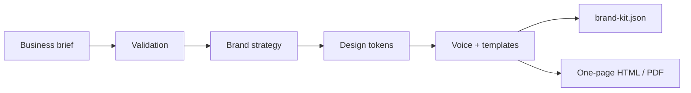

# 04 — Brand Kit Generator

> Weekend Homework project page. Keep your notes, decisions, screenshots and demo link on this page.

| Field | Value |
|---|---|
| Status | Not started |
| Repository |  |
| Demo |  |
| Date finished |  |

## My build notes

- My twist:
- My stack changes:
- Biggest blocker:
- What I would do next:

---

## Outcome

Build a generator that turns a short business brief into a coherent, downloadable brand kit. Of the five projects, this is the easiest to turn into a paid deliverable because businesses already understand the output.

**Timebox:** 2–3 hours  
**Difficulty:** Beginner to intermediate  
**Core skills:** structured generation, design tokens, forms, validation, export design, client deliverables

## What the finished build does

- Collects a business brief: name, offer, audience, location, personality, competitors and constraints.
- Generates a positioning line and message pillars.
- Produces a colour palette with named colours and HEX values.
- Selects a typography pairing with a stated reason.
- Defines logo direction and image style without pretending a text prompt is a finished logo.
- Writes voice rules with examples of what to say and what to avoid.
- Exports a polished one-page HTML brand sheet and a structured `brand-kit.json`.
- Includes sample social-post templates using the generated tokens.

## Architecture

## Suggested stack

- A small local web app or CLI plus HTML export
- Structured JSON as the source of truth
- CSS variables generated from the design tokens
- Optional AI generation for strategy and copy
- Deterministic validation for colour contrast, required fields and file output

Do not make the exported page depend on hand-editing the JSON. The generator should rebuild the kit from the brief.

## Sample briefs

Create two fictional businesses with different personalities:

1. **Northline Plumbing** — reliable, direct, emergency service, trades audience.
2. **Maison Fable** — warm, design-led, premium home goods, gift buyers.

If both kits look interchangeable, the generator is not working.

## Build order

### Step 1 — Define the brief and JSON schema

> Read `CLAUDE.md`. Design the business-brief form and the `brand-kit.json` schema before building UI. Required brand-kit sections: positioning, audience, message pillars, colours, typography, logo direction, image style, voice rules and social templates. Show me a completed example for Northline Plumbing.

### Step 2 — Build brief intake

> Build a form or CLI intake that validates the required brief fields and saves the brief as JSON. Include personality sliders or choices for practical/playful, budget/premium and traditional/bold. Do not generate the kit yet.

### Step 3 — Generate strategy before visuals

> Add the strategy generator. From the brief, produce positioning, audience summary and three message pillars. The output must reference facts from the brief and must not invent testimonials, awards, years in business or service guarantees.

### Step 4 — Generate design tokens

> Add palette and typography generation. Every colour needs a name, HEX value, intended use and text/background pairing. Check basic contrast for the main text combinations and flag failures instead of hiding them. Typography choices must include heading font, body font and a fallback stack.

### Step 5 — Add voice and templates

> Generate voice rules with three “say this” and three “not this” examples based on the brief. Then create two social-post templates and one website hero section using the strategy and tokens. The examples must be visibly different for the plumbing and home-goods briefs.

### Step 6 — Export the one-page brand sheet

> Build a polished HTML brand sheet from `brand-kit.json`: logo direction, palette swatches, typography specimens, voice examples, message pillars and sample hero. Add a print stylesheet so the same page can be saved as a clean PDF.

### Step 7 — Regeneration and editing

> Add the ability to edit one brief field and regenerate only the affected sections where practical. At minimum, changing the business personality must change the strategy, palette rationale and voice examples on the next full regeneration.

## Definition of done

- [ ] Two fictional briefs can be saved and validated.
- [ ] Each generates a complete `brand-kit.json`.
- [ ] The two kits are clearly different in strategy, palette and voice.
- [ ] Main colour combinations pass or are flagged for contrast.
- [ ] A polished one-page HTML brand sheet exports from the JSON.
- [ ] The sheet can be printed or saved as a readable PDF.
- [ ] No testimonials, awards or guarantees are invented.
- [ ] Logo output is labelled as direction, not presented as a finished identity.

## Common pitfalls

- **Random colour generator.** Every token needs a reason tied to audience and positioning.
- **Generic voice.** “Professional yet friendly” is not a voice rule. Show examples.
- **Fake proof.** Never invent reviews, credentials or results to make the kit look complete.
- **Pretty export, no source data.** The structured JSON is the reusable asset.

## Stretch goals

- Upload an existing logo and extract a starting palette.
- Generate favicon and social-avatar concepts from the approved direction.
- Create a mini brand-guideline document with misuse examples.
- Add client approval states: draft, reviewed, approved.

## Make it a product

Package the human-reviewed version as a starter identity deliverable: brief call, generated first pass, designer review, palette and type lock, voice guide, templates and export. The generator accelerates the work; your review is the quality gate.

## Submit it

Show both sample brand sheets side by side. The contrast between the two businesses is the proof.

---

# Brand Kit Generator — Build Checklist

## Setup
- [ ] New implementation repo created
- [ ] `STARTER-CLAUDE.md` copied to `CLAUDE.md`
- [ ] Two fictional business briefs written
- [ ] Brand-kit JSON schema drafted

## Build
- [ ] Brief intake validates required fields
- [ ] Strategy generation uses brief facts only
- [ ] Palette and typography tokens generated
- [ ] Contrast checks or flags work
- [ ] Voice examples generated
- [ ] Social and hero templates generated
- [ ] HTML brand sheet exports from JSON

## Verify
- [ ] Plumbing and home-goods kits are visibly distinct
- [ ] Print/PDF output is clean
- [ ] No proof or credentials were invented
- [ ] Editing the brief changes the regenerated kit

## Share
- [ ] Both brand sheets captured
- [ ] Sample JSON included or shown
- [ ] README explains the human review step
- [ ] Showcase submission completed
