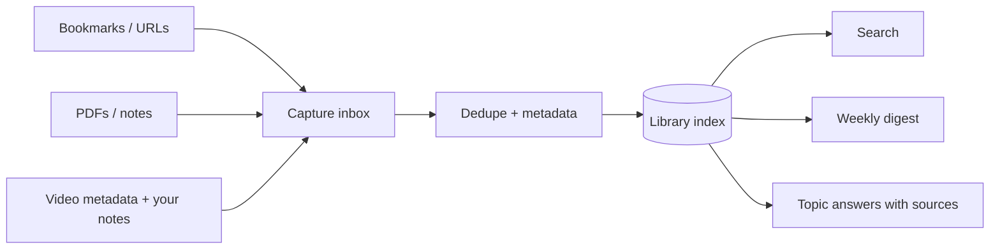

# 05 — Life Library

> Weekend Homework project page. Keep your notes, decisions, screenshots and demo link on this page.

| Field | Value |
|---|---|
| Status | Not started |
| Repository |  |
| Demo |  |
| Date finished |  |

## My build notes

- My twist:
- My stack changes:
- Biggest blocker:
- What I would do next:

---

## Outcome

Build a searchable personal library for the articles, videos, newsletters, PDFs and notes you save. The goal is not hoarding links; it is being able to find and reuse what you already consumed.

**Timebox:** about 2 hours  
**Difficulty:** Beginner to intermediate  
**Core skills:** capture pipelines, metadata, deduplication, full-text search, digests, recommendations

## What the finished build does

- Imports bookmarks, URLs and local files into one inbox.
- Extracts readable article text where access is legitimate and available.
- Stores source, author, date, topics, personal note and consumption status.
- Removes duplicates by canonical URL or file hash.
- Searches titles, notes and full text.
- Answers “what have I saved about X?” with links back to the sources.
- Produces a weekly resurfaced-reading digest.

## Architecture

## Suggested stack

- Python CLI or small local web app
- SQLite with FTS5 full-text search
- Browser-bookmark HTML or CSV import
- A readability extractor for pages you are allowed to access
- File hashing for local documents
- Optional semantic search after keyword search works

## Content and access rules

- Save your own notes for videos and podcasts. Add transcripts only when the source provides one or you supply it.
- Do not bypass paywalls, login walls or platform restrictions.
- Keep the original link with every extracted item so the source remains reachable and credited.

## Sample library

Create at least 25 test items:

- 10 article URLs or local HTML/text fixtures
- 5 PDFs or Markdown notes
- 5 video entries with your own short notes
- 3 duplicate URLs with tracking parameters
- 2 items with the same title but different sources

Use public-domain or fictional material for the public demo.

## Build order

### Step 1 — Define the library record

> Read `CLAUDE.md`. Design the library schema before building importers. Required fields: ID, title, source URL or file path, source type, author when known, published date when known, captured date, raw text or note, topics, status and personal note. Show me three example records.

### Step 2 — Build the capture inbox

> Add commands or a simple form to save one URL, one local file and one manual note. New items land in an `inbox` state. Do not fetch the web yet. Prove that all three record types can be created.

### Step 3 — Import bookmarks and deduplicate

> Add a browser-bookmark HTML or CSV importer. Normalize URLs by removing common tracking parameters, then deduplicate by canonical URL. Local files deduplicate by SHA-256 hash. Print how many items were imported, skipped and merged.

### Step 4 — Extract and enrich

> For accessible article fixtures, extract readable text and store it for search. For videos, store metadata and my note; do not claim a transcript exists unless I supplied one or the source provides it. Add topic suggestions that I can accept or edit.

### Step 5 — Full-text search

> Build search over title, author, topics, personal notes and extracted text using SQLite FTS5. Results must show why each item matched and link back to the original source. Test exact-phrase and topic searches.

### Step 6 — Ask the library

> Add a `what have I saved about...` command that returns a grouped source list, not an unsourced essay. It may summarize themes only from returned records and must show the item titles and links beside the summary.

### Step 7 — Weekly resurfacing digest

> Add a digest command that selects five items: one unfinished, one older item relevant to a current topic, one highly noted item, and two random saves. Write the result to `digest.md` with a one-line reason for each pick.

## Definition of done

- [ ] At least 25 sample items are imported.
- [ ] URL tracking parameters do not create false duplicates.
- [ ] Duplicate local files are detected by hash.
- [ ] Search covers titles, notes, topics and extracted text.
- [ ] Every result links back to its original source.
- [ ] “What have I saved about X?” returns a sourced list.
- [ ] A five-item weekly digest is generated with reasons.
- [ ] Video records do not pretend to include unavailable transcripts.

## Common pitfalls

- **Saving everything, finding nothing.** Metadata and search are the product.
- **Scraping first.** Start with records and imports; extraction is one adapter.
- **Losing the source.** Extracted text without the original link is a dead end.
- **Fake transcripts.** Your note is valuable; do not dress it up as the creator’s words.

## Stretch goals

- Browser one-click capture.
- Read-it-later status sync.
- Topic maps that show clusters and gaps.
- A monthly “ideas I keep coming back to” report.
- Semantic search layered over the FTS index.

## Make it yours

Specialize the library: research for a book, business ideas, health information you discuss with a clinician, trade references, course material or content research. A named purpose produces better topics and digests.

## Submit it

Show the duplicate test, one search result and the weekly digest. Those three outputs prove capture, retrieval and resurfacing.

---

# Life Library — Build Checklist

## Setup
- [ ] New implementation repo created
- [ ] `STARTER-CLAUDE.md` copied to `CLAUDE.md`
- [ ] Library schema drafted
- [ ] 25-item sample set assembled

## Build
- [ ] Manual URL, file and note capture works
- [ ] Bookmark import works
- [ ] Canonical URL deduplication works
- [ ] File-hash deduplication works
- [ ] Extraction and topic enrichment work
- [ ] FTS5 search works
- [ ] Topic query returns sourced results
- [ ] Weekly digest generated

## Verify
- [ ] Tracking-parameter duplicates are merged
- [ ] Same-title/different-source items remain separate
- [ ] Search results explain matches
- [ ] Video records are honest about transcripts
- [ ] Original links remain attached to extracted text

## Share
- [ ] Search screenshot captured
- [ ] Digest screenshot captured
- [ ] README explains capture and access boundaries
- [ ] Showcase submission completed
