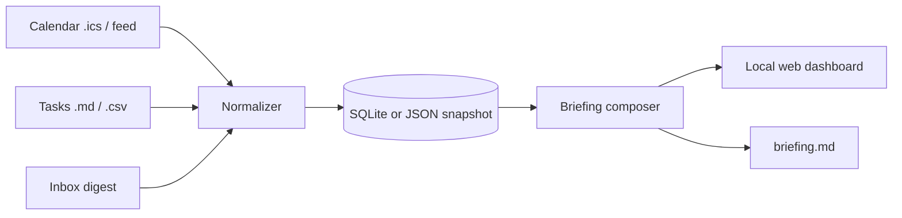

# Project 01 — Personal Dashboard

## Outcome

Build a local dashboard that turns your calendar, task list and inbox summary into one morning briefing. The point is not another pretty homepage; it is a reliable daily operating picture.

**Timebox:** 2–3 hours  
**Difficulty:** Beginner to intermediate  
**Core skills:** APIs and files, data adapters, scheduling, basic UI, briefing design

## What the finished build does

- Reads today's calendar events from an `.ics` file or a read-only calendar feed.
- Reads open tasks from a Markdown or CSV file.
- Accepts a short inbox digest that you provide manually or through an authorized email integration.
- Shows today’s schedule, priorities, deadlines and conflicts on one page.
- Generates a concise morning briefing as a web page and a Markdown file.
- Works with sample data before you connect anything personal.

## Architecture

Keep adapters separate. Calendar parsing, task parsing and briefing composition should not be tangled together.

## Suggested stack

- Python 3.11+
- FastAPI or Flask
- SQLite
- `icalendar` for `.ics` parsing
- Plain HTML/CSS or a small template engine
- Optional: Ollama for a natural-language summary after the deterministic briefing works

You may use another stack, but keep the same architecture and definition of done.

## Before you start

- Create a new repository for your implementation.
- Copy `STARTER-CLAUDE.md` into it as `CLAUDE.md`.
- Do not start with real credentials. Use the sample data described below.
- Decide where your real calendar export and task file live, but keep them outside the public repo.

## Sample data

Create:

- `samples/calendar.ics` with at least five events today, including one overlap.
- `samples/tasks.csv` with title, due date, priority, project and status columns.
- `samples/inbox-digest.md` with five fictional messages, two requiring action.

## Build order

### Step 1 — Scaffold and sample-data contract

Paste this into Claude Code:

> Read `CLAUDE.md`. Scaffold the project using the suggested stack. Create the folder structure, a sample-data loader, and a `/health` route or CLI check. Do not build the dashboard yet. Show me the exact command to verify the scaffold runs.

Verify the empty app runs before continuing.

### Step 2 — Normalize tasks

> Build the task adapter only. It must read `samples/tasks.csv`, ignore completed tasks, sort by due date and priority, and return a documented Python object. Add a small test or print command that proves overdue and due-today tasks are identified correctly.

### Step 3 — Normalize calendar events

> Build the calendar adapter only. It must read `samples/calendar.ics`, return today’s events in local time, and flag overlapping events. Keep time-zone handling explicit. Show me the parsed events for the sample file before building UI.

### Step 4 — Add the inbox digest boundary

> Add an inbox-digest adapter that reads a Markdown file I provide. Do not request email passwords and do not scrape an inbox. The adapter should extract action items under an `Action needed` heading and ignore the rest for v1.

### Step 5 — Compose the briefing deterministically

> Build a briefing composer that takes normalized calendar, task and inbox objects and writes `briefing.md`. Start with headings, facts and deadlines — no AI summary yet. The output must include: first event, hard deadlines, top three tasks, conflicts and action items.

### Step 6 — Build the one-page dashboard

> Build a clean local dashboard that displays the same normalized data as the briefing. Prioritize scanability over decoration: today’s timeline, top tasks, conflicts and inbox actions. It must still look complete with only sample data.

### Step 7 — Optional AI polish

> Only after the deterministic briefing passes, add an optional local-model summary through Ollama. If Ollama is unavailable, the dashboard and briefing must still work. Never send the underlying personal data to a cloud model in this step.

### Step 8 — Make it daily

> Add a `make-briefing` command that refreshes the snapshot and regenerates the briefing. Document how to run it manually and how a user could schedule it with their operating system. Do not install a background service without asking.

## Definition of done

- [ ] The app runs locally from a documented command.
- [ ] Sample calendar, task and inbox data load without errors.
- [ ] Overlapping calendar events are flagged.
- [ ] Overdue and due-today tasks are visibly separated.
- [ ] The briefing is generated from normalized data, not hard-coded text.
- [ ] The dashboard and `briefing.md` agree with each other.
- [ ] The app still works if the optional AI summary is unavailable.
- [ ] No real password, token or private export is committed.

## Common pitfalls

- **Connecting real accounts first.** You will debug credentials instead of learning data flow.
- **Letting the AI invent the briefing.** Facts first; language polish second.
- **Time-zone shortcuts.** Store the intended local time zone and test an event near midnight.
- **A dashboard with twelve widgets.** One useful screen beats a control room.

## Stretch goals

- Weather and commute cards from public APIs.
- A “shutdown” mode that compares planned tasks with completed tasks.
- Calendar sources through official read-only APIs.
- A printable one-page briefing.

## Make it yours

Adapt the dashboard to a role: contractor, student, parent, job seeker, creator or small-business operator. A role-specific morning brief is more valuable than a generic productivity clone.

## Submit it

Follow the definition of done, capture the dashboard and briefing side by side, then use the showcase submission template in the root repository.
