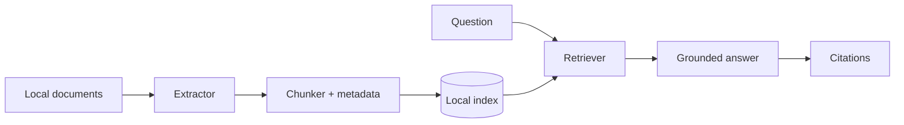

# Project 02 — Second Brain

## Outcome

Build a local system that ingests your documents and answers questions with citations. This is the most personally useful project in the pack — and the one where privacy matters most.

**Timebox:** about 3 hours  
**Difficulty:** Intermediate  
**Core skills:** document extraction, chunking, embeddings, retrieval, grounded answers, incremental indexing

## What the finished build does

- Watches or scans a local `documents/` folder.
- Extracts text from PDF, Markdown and plain-text files.
- Splits documents into searchable chunks with source metadata.
- Builds a local index and avoids reprocessing unchanged files.
- Answers questions using retrieved passages only.
- Cites the file name and page or section for every factual claim.
- Says “I don’t know from these documents” when the answer is not present.

## Architecture

## Suggested stack

- Python 3.11+
- `pypdf` for PDFs
- Markdown and text readers
- SQLite for document and chunk metadata
- A local vector store or a small vector index you can inspect
- Ollama with a local embedding model and a local chat model
- CLI first; add a web UI only after retrieval works

Equivalent tools are fine. Hosted embeddings or hosted chat change the privacy model and must be clearly labelled if you choose them.

## Privacy rule

Use fictional documents for the public demo. Court papers, contracts, tax records, medical documents and family records should stay on your own machine if you adapt this for real use. Never commit a real document corpus to the public implementation repo.

## Sample corpus

Create five small fictional documents:

1. A home-insurance summary with renewal date and coverage amount.
2. A rental agreement with deposit and notice-period clauses.
3. A software subscription receipt with renewal terms.
4. A project contract with payment milestones.
5. A meeting-notes file with three decisions and owners.

Plant exact answers in the documents so retrieval can be tested.

## Build order

### Step 1 — Scaffold and document inventory

> Read `CLAUDE.md`. Scaffold a CLI project. Build an `inventory` command that scans a documents folder, lists supported files, records file size and SHA-256 hash, and stores the result in SQLite. Do not extract text yet. Verify it on the sample folder.

### Step 2 — Extract text with metadata

> Add extractors for PDF, Markdown and TXT. For every document, preserve file name, relative path, page number when available, character count and extraction warnings. A scanned PDF with no text should be reported as needing OCR, not silently indexed as empty.

### Step 3 — Chunk for retrieval

> Add a chunker that splits extracted text into overlapping chunks suitable for question answering. Every chunk must carry document ID, page or heading, chunk order and the original text. Print three sample chunks so I can inspect the boundaries.

### Step 4 — Build the local index

> Add an indexing command using a local embedding model through Ollama. Store vectors locally with their chunk IDs. Re-running the command must skip unchanged files by hash and re-index changed files only.

### Step 5 — Retrieval before generation

> Build a `search` command that returns the top matching chunks with file and page citations, without generating an answer. Test it against questions whose answers are planted in the sample corpus. Tune chunking or retrieval here, not in the answer prompt.

### Step 6 — Grounded answers

> Add an `ask` command. It may answer only from retrieved chunks, must cite the file and page/section for factual claims, and must say it does not know when retrieval does not contain the answer. Show the retrieved sources under the answer in debug mode.

### Step 7 — Incremental updates and deletion

> Add commands to show index status, re-index one file, and remove a deleted document’s chunks. Prove that editing one document does not rebuild the entire index.

### Step 8 — Optional interface

> Only after the CLI passes the definition of done, add a simple local web interface with a document list, question box, answer and citations. Keep the CLI functional.

## Test questions

Use questions with known answers:

- “When does the home insurance renew?”
- “How much notice is required in the rental agreement?”
- “Which payment milestone follows the design approval?”
- “Who owns the second meeting decision?”
- “What is the phone number in the insurance document?” — only answer if it is actually present.

Also ask one question that no document answers. The correct result is a refusal grounded in missing evidence.

## Definition of done

- [ ] At least five sample documents are inventoried and extracted.
- [ ] Chunks preserve document, page/section and order metadata.
- [ ] Search returns relevant passages before any answer is generated.
- [ ] Answers cite their sources.
- [ ] An unanswerable question produces “not in these documents” or equivalent.
- [ ] Editing one file triggers only that file’s re-indexing.
- [ ] Deleted files can be removed from the index.
- [ ] No real private documents or cloud credentials are committed.

## Common pitfalls

- **Starting with the chat box.** Retrieval quality is the product; the chat box is packaging.
- **Chunks without citations.** An answer you cannot trace is a rumour.
- **Huge chunks.** They dilute relevance and waste context.
- **Indexing everything forever.** Hashing and deletion are core features, not cleanup.
- **Pretending scanned PDFs worked.** Report OCR gaps honestly.

## Stretch goals

- OCR for scanned PDFs.
- Folder watching and automatic incremental indexing.
- Contradiction detection between documents.
- Expiry radar for renewals, warranties and deadlines.
- An Obsidian-compatible vault view.

## Make it yours

Build the corpus around one job: client contracts, course notes, research papers, equipment manuals, family administration or business records. A focused second brain is easier to verify than a lifetime archive dumped into one folder.

## Submit it

Demo the planted-answer questions and the unanswerable question. That pair shows both capability and honesty.
